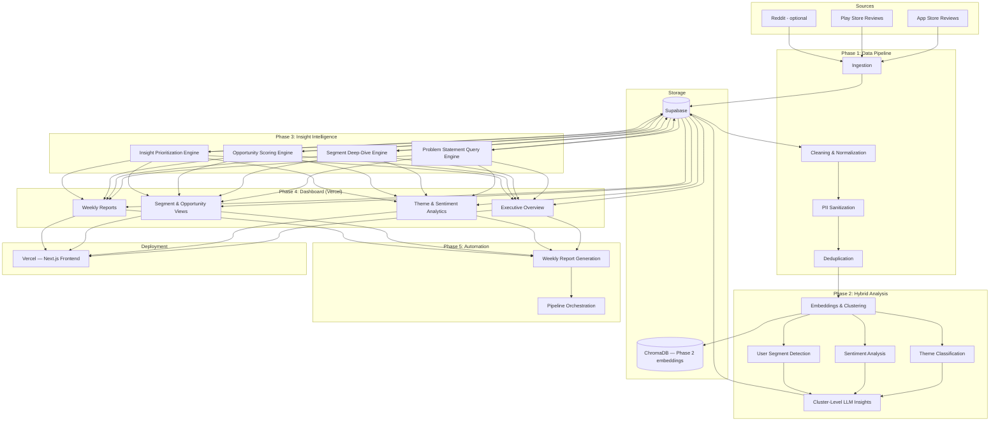
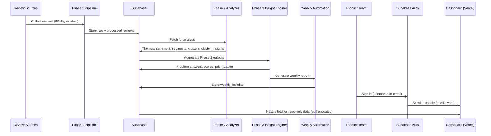

# System Architecture: AI-Powered Review Discovery Engine

## 1. System Overview

The AI-Powered Review Discovery Engine is a **Product Decision Intelligence Platform** that ingests Spotify user reviews, processes them through a hybrid analysis pipeline, and produces actionable insights for the Growth Team.

It is designed to answer the core questions in [Problem statement.md](./Problem%20statement.md):

- Why do users struggle to discover new music?
- What frustrates users about recommendations?
- What listening behaviors are users trying to achieve?
- What causes repetitive listening?
- Which behavioral segments face the biggest discovery challenges?
- What unmet needs emerge consistently?

**Design principles:** Scalability, modularity, actionability, and data retention (Supabase as permanent store).

**Insight constraint:** Insights must be supported by review text, ratings, timestamps, sources, and Phase 2 outputs only. Demographic inference (age, student/professional/parent profiles) is excluded from primary decision-making.

---

## 2. Storage Architecture

| Layer | Technology | Role |
|-------|-----------|------|
| **Primary Storage** | Supabase (PostgreSQL) | Source of truth — raw reviews, processed reviews, cluster insights, weekly insights, historical trends |
| **Vector Store (Phase 2)** | ChromaDB | Persistent embedding store for Phase 2.1 — collection `reviews` at `data/chroma_db`; used by weekly pipeline for upsert, incremental skip, and clustering |
| **Vector Store (Phase 3.1, optional)** | ChromaDB | Optional collection `review_knowledge` for semantic quote retrieval — separate script, not in scheduled pipeline |

Supabase holds all historical data permanently and receives final `cluster_id` and analysis fields. ChromaDB holds review embeddings for the clustering pipeline; the dashboard never reads ChromaDB directly. GitHub Actions caches `data/chroma_db` between weekly runs.

---

## 3. High-Level Architecture

---

## 4. Component Breakdown

### 4.1 Phase 1 — Data Pipeline

| Component | Responsibility |
|-----------|---------------|
| Ingestion | Collect reviews (90-day window) from App Store, Play Store, optional Reddit |
| Cleaning | Normalize dates, remove noise, standardize fields |
| PII Sanitization | Strip emails, phones, URLs |
| Deduplication | Exact + fuzzy dedup |

### 4.2 Phase 2 — Hybrid AI Analysis Engine

| Component | Responsibility |
|-----------|---------------|
| Embeddings & Clustering | Local sentence-transformers (default) or OpenAI; embeddings persisted in **ChromaDB** (`reviews` collection); cluster IDs written to Supabase |
| Theme Classification | Cluster-level themes propagated to reviews |
| Sentiment Analysis | VADER/TextBlob polarity and scores |
| User Segment Detection | Rule-based segments (New User, Casual, Premium, Heavy, Niche) |
| Cluster LLM Insights | Groq cluster-level pain points, severity, opportunities, quotes |

Phase 2 minimizes LLM cost by using lightweight models for per-review tasks and Groq only at cluster level (~5 calls vs. tens of thousands).

### 4.3 Phase 3 — Insight Intelligence Layer

| Component | Responsibility |
|-----------|---------------|
| Problem Statement Query Engine | Answers six core discovery questions with evidence-backed structured output |
| Segment Deep-Dive Engine | Behavioral segment profiles (Discovery Seeker, Habit Listener, Heavy Listener, Playlist Driven, Niche Listener, Casual Listener) |
| Opportunity Scoring Engine | Ranks opportunities: Frequency × Severity × Segment Impact × Sentiment Intensity |
| Insight Prioritization Engine | Tiered action list: pain points, friction scores, opportunities, recommendations |

Phase 3 maps Phase 2 segment labels to a behavioral taxonomy for decision-facing reporting. No demographic segmentation.

### 4.4 Phase 4 — Dashboard & Analytics (Vercel)

| View | Purpose |
|------|---------|
| Executive Overview | KPIs, top friction segment, top opportunity |
| Problem Statement Insights | Six core questions with metrics and quotes |
| Theme & Sentiment Analytics | Distribution and trend charts |
| Segment Deep-Dives | Five-level segmentation comparison (see [reference.png](./reference.png)) |
| Opportunity Ranking | Prioritized product bets with evidence |
| Insight Prioritization | Critical / High / Monitor action matrix |
| Weekly Reports | Emerging pain points and week-over-week changes |

**Frontend:** Next.js + React + Tailwind + Recharts, deployed on **Vercel**.

**Auth:** Supabase Auth (required before production). Middleware protects dashboard routes; `profiles` table stores username + email; login and password reset accept username or email. SQL: `supabase/auth_profiles.sql`.

**Data:** Read-only Supabase access via `@supabase/supabase-js`; Phase 3 JSON from `weekly_insights.top_themes`.

**Filters:** date range, source, theme, sentiment, five-level segmentation (Business, Engagement, Behavior, Context, Pain), cluster, opportunity tier.

### 4.5 Phase 5 — Weekly Reporting & Automation

Automated weekly reports (emerging complaints, theme shifts, segment changes, new opportunities, executive summary) plus end-to-end **Python** pipeline orchestration and scheduling. The Vercel dashboard reads updated Supabase data after each run — no frontend redeploy required for data refresh.

---

## 5. Data Flow

---

## 6. Technical Stack

| Category | Choice |
|----------|--------|
| Language (pipeline) | Python 3.11+ |
| Language (dashboard) | TypeScript / Next.js |
| Primary Storage | Supabase (PostgreSQL) |
| LLM (cluster insights) | Groq `llama-3.3-70b-versatile` |
| Embeddings | Local sentence-transformers (default) or OpenAI |
| Vector Store | ChromaDB — **Phase 2 required** (`reviews`); Phase 3.1 optional (`review_knowledge`) |
| Sentiment | VADER, TextBlob |
| Clustering | scikit-learn (K-Means, DBSCAN) |
| Dashboard frontend | Next.js + React + Tailwind + Recharts |
| Dashboard deployment | **Vercel** |
| Dashboard auth | Supabase Auth + Next.js middleware |
| Testing | pytest (Python), optional Vitest/Jest (frontend) |

---

## 7. Supabase Schema

| Table | Purpose |
|-------|---------|
| `raw_reviews` | Permanent raw review storage (source, text, rating, date) |
| `processed_reviews` | Cleaned text, themes, sentiment, user_segment, cluster_id, pain_points |
| `cluster_insights` | Cluster-level pain points, severity, opportunities, quotes |
| `weekly_insights` | Weekly reports and problem-statement snapshots |
| `historical_trends` | Theme/sentiment aggregates over time |

---

## 8. Key Design Decisions

1. **Hybrid analysis over per-review LLM** — Lightweight models + cluster-level Groq calls scale to ~50k reviews.
2. **Behavioral segmentation for decisions** — Phase 3 uses six behavioral segments; demographics are not inferred.
3. **Supabase-first insight layer** — Phase 3 engines aggregate structured Phase 2 data from Supabase. ChromaDB supports Phase 2 clustering (weekly pipeline) and optional Phase 3.1 semantic retrieval; the dashboard reads Supabase only.
4. **Evidence-backed outputs** — Every insight links to metrics, themes, cluster summaries, or review quotes.
5. **Modular phases** — Each phase is independently testable and deployable.
6. **Vercel for frontend, Python for pipeline** — Analysis runs locally or on a scheduler; dashboard hosted on Vercel with read-only Supabase access.
