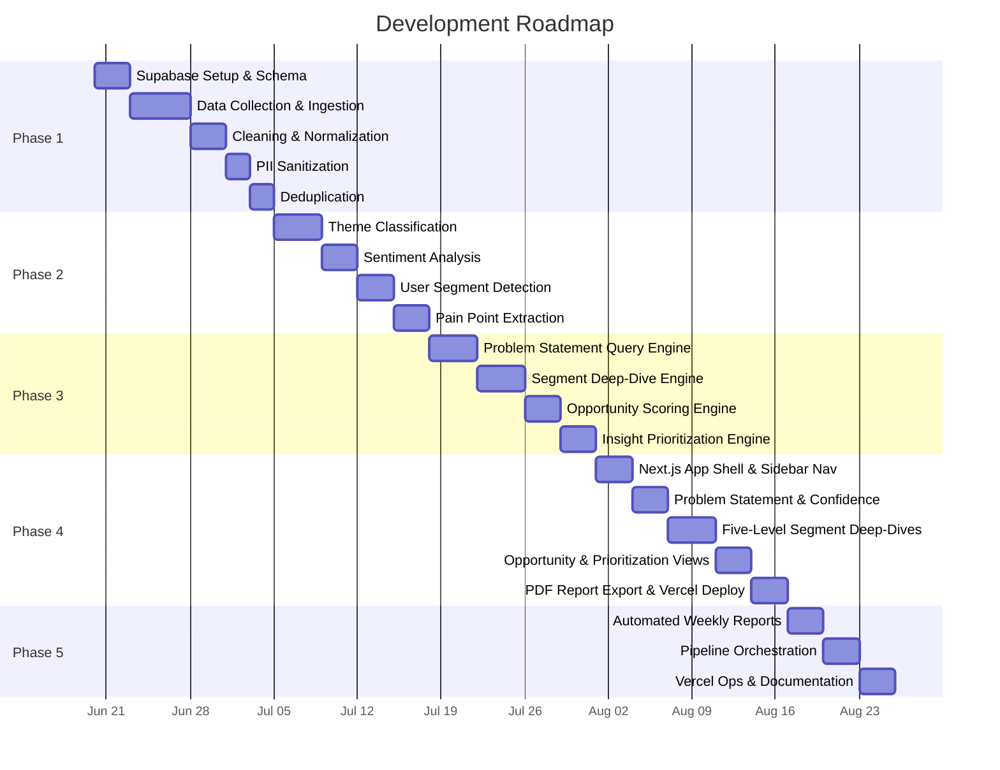

# Phase-Wise Implementation Plan

This document outlines the development roadmap for the **AI-Powered Review Discovery Engine** — a Product Decision Intelligence Platform that answers the core questions in [Problem statement.md](./Problem%20statement.md).

**Architecture:** Supabase (permanent structured storage) + **ChromaDB** (Phase 2 embedding store for clustering; optional Phase 3.1 knowledge collection). **Rolling 90-day window** for ingestion and active analysis. Phases 3–5 convert Phase 2 outputs into behavioral insights, dashboards, and automated weekly reports — without demographic inference beyond what review data supports.

---

## Phase 1: Data Pipeline, Ingestion & Storage Setup

**Objective:** Build a robust pipeline to collect, clean, and prepare Spotify user reviews, and set up the dual-storage infrastructure.

### 1.1 Storage Infrastructure Setup

- **Action:** Set up Supabase project and database schema.
- **Details:**
  - Create a Supabase project and configure authentication.
  - Define the database schema with tables: `raw_reviews`, `processed_reviews`, `weekly_insights`, `historical_trends`.
  - Set up `supabase-py` client in the project for Python-based database operations.
  - Configure Row Level Security (RLS) policies as needed.
- **Output:** Fully configured Supabase instance with schema ready for data insertion.

### 1.2 Data Collection & Ingestion

- **Action:** Set up scrapers/API connectors for Spotify reviews from Google Play Store and Apple App Store.
- **Details:**
  - Collect reviews from the **last 90 days (3 months)** on each full ingestion run — reviews older than 90 days are excluded at fetch time.
  - Use `google-play-scraper` to fetch Play Store reviews with metadata (date, rating, thumbs-up count, version).
  - Use `app-store-scraper` for Apple App Store reviews.
  - Optionally use Reddit's PRAW API to scrape relevant subreddits (r/spotify, r/musicsuggestions).
  - Store **raw reviews directly into Supabase** (`raw_reviews` table) as the source of truth.
- **Output:** Raw review dataset in Supabase covering the last 90 days (target: 5,000–10,000+ reviews per full run).

### 1.3 Data Cleaning & Normalization

- **Action:** Standardize review data for downstream processing.
- **Details:**
  - Fetch raw reviews from Supabase for processing.
  - Normalize date formats to ISO 8601.
  - Remove HTML entities, excessive whitespace, and encoding artifacts.
  - Filter out empty or extremely short reviews (< 10 characters).
  - Standardize column names across sources (e.g., `review_text`, `rating`, `date`, `source`).
- **Output:** Clean, unified review dataset.

### 1.4 PII Sanitization

- **Action:** Strip personally identifiable information from review text.
- **Details:**
  - Use regex patterns to redact emails, phone numbers, and URLs.
  - Optionally use spaCy NER to detect and mask names.
  - Ensure no PII reaches the LLM or storage layers.
- **Output:** Sanitized review dataset ready for LLM processing.

### 1.5 Deduplication

- **Action:** Remove duplicate and near-duplicate reviews.
- **Details:**
  - Exact match deduplication on review text hash.
  - Fuzzy deduplication using MinHash / Jaccard similarity for near-duplicates.
- **Output:** Deduplicated dataset with unique reviews only.

### Phase 1 Exit Criteria

- Supabase project created with all required tables
- Successfully ingested 5,000+ reviews from at least 2 sources into Supabase
- All reviews cleaned, normalized, and deduplicated
- Zero PII present in processed dataset
- Raw reviews stored permanently in Supabase `raw_reviews` table

---

## Phase 2: Hybrid AI Analysis Engine

**Objective:** Use a scalable hybrid approach combining embeddings, clustering, lightweight classification, and cluster-level LLM calls to analyze ~50,000 reviews efficiently. Store all analysis results back to Supabase while maintaining compatibility with downstream phases.

### 2.1 Embedding Generation & Clustering

- **Action:** Generate embeddings for all processed reviews and cluster semantically similar reviews.
- **Details:**
  - Generate vector embeddings using **local sentence-transformers** (`all-MiniLM-L6-v2`, default) or OpenAI `text-embedding-3-small` when `EMBEDDING_BACKEND=openai`.
  - **Store embeddings in ChromaDB** (`data/chroma_db`, collection `reviews`) — used every weekly run for upsert, incremental skip, and clustering input.
  - Apply clustering algorithms to group semantically similar reviews:
    - K-Means for initial clustering
    - DBSCAN or HDBSCAN for density-based clustering
  - Expected semantic clusters: Repetitive Recommendations, Playlist Fatigue, Discover Weekly Issues, Algorithm Bias, Niche Discovery Issues.
  - Assign cluster IDs to reviews in Supabase `processed_reviews` table.
- **Output:** Embeddings stored in ChromaDB, cluster-labeled review dataset in Supabase.

### 2.2 Theme Classification

- **Action:** Assign theme labels to clusters and propagate to individual reviews.
- **Details:**
  - Replace review-level LLM classification with cluster-level classification.
  - Use lightweight methods for theme assignment:
    - Keyword mapping from cluster centroids
    - Zero-shot classification using Hugging Face models
    - Lightweight transformer models (e.g., BERT-based classifiers)
  - Assign theme labels to each cluster based on dominant keywords and semantic patterns.
  - Propagate cluster theme labels to all reviews within each cluster.
  - Store theme labels in Supabase `processed_reviews` table (compatible with Phase 4 reporting and trend tracking).
- **Output:** Theme-labeled dataset in Supabase.

### 2.3 Sentiment Analysis

- **Action:** Determine sentiment polarity and intensity for each review using lightweight models.
- **Details:**
  - Replace LLM-based sentiment analysis with efficient sentiment models:
    - VADER for rule-based sentiment scoring
    - TextBlob for polarity analysis
    - DistilBERT sentiment model for transformer-based analysis
  - Assign sentiment polarity (positive/neutral/negative) and sentiment score (1-5).
  - Calculate severity score based on sentiment intensity and keyword patterns.
  - Store sentiment scores in Supabase `processed_reviews` table (compatible with Phase 4 reporting).
- **Output:** Sentiment-scored dataset in Supabase.

### 2.4 User Segment Detection

- **Action:** Infer user type using rule-based and lightweight classifier approaches.
- **Details:**
  - Replace LLM-heavy segmentation with hybrid approach:
    - Rule-based detection using metadata and language patterns
    - Lightweight classifier models for segment assignment
  - Segments: New User, Casual Listener, Premium User, Heavy Listener, Niche Music Listener.
  - Rule-based examples:
    - "I just started using Spotify" → New User
    - "I pay for Premium but..." → Premium User
    - High engagement metrics → Heavy Listener
  - Store segment labels in Supabase `processed_reviews` table (compatible with Phase 4 dashboards and opportunity scoring).
- **Output:** Segment-labeled dataset in Supabase.

### 2.5 Cluster-Level LLM Insight Generation

- **Action:** Use LLM only at cluster level to extract insights, reducing LLM usage by 90-98%.
- **Details:**
  - Aggregate representative reviews from each cluster (e.g., top 10-20 most representative).
  - Summarize cluster context and dominant patterns.
  - Send cluster summaries to LLM (Groq or OpenAI) for insight extraction.
  - LLM extracts:
    - `pain_point`: Primary complaint or issue
    - `severity`: Impact level (1-5)
    - `feature_request`: Suggested improvements
    - `representative_user_quotes`: Key quotes from cluster
    - `product_opportunity`: Business opportunity identification
  - Example: 500 similar reviews = 1 LLM call instead of 500 calls.
  - Store insights in Supabase `processed_reviews` and `weekly_insights` tables (compatible with Phase 4 reporting).
- **Output:** Structured cluster insights in Supabase, representative user quotes, product opportunities.

### Phase 2 Exit Criteria

- All reviews assigned to semantic clusters with embeddings stored in ChromaDB
- All reviews classified with at least one theme (cluster-level propagation)
- Sentiment scores assigned to 100% of reviews using lightweight models
- User segments detected using rule-based and lightweight classifiers
- Cluster-level insights extracted with structured output
- All analysis results stored in Supabase `processed_reviews` and `weekly_insights` tables
- LLM usage reduced by 90-98% compared to review-level approach
- Output fully compatible with Phase 3 (insight intelligence), Phase 4 (dashboard), and Phase 5 (weekly automation)

---

## Phase 3: Insight Intelligence Layer

**Objective:** Build a realistic **Product Decision Intelligence** engine on top of the completed Phase 2 hybrid analyzer. Transform structured review intelligence into deep behavioral and product insights that product and growth teams can act on.

**Data Foundation (preserve existing stack):**

- **Supabase (permanent):** `raw_reviews`, `processed_reviews`, `cluster_insights`, `weekly_insights`, `historical_trends` — no schema redesign required.
- **Phase 2 outputs (inputs):** themes, sentiment, behavioral segments, cluster IDs, cluster-level pain points, product opportunities.
- **Available signals:** review text, ratings, timestamps, sources, and Phase 2 classifications only.
- **Optional accelerator:** Phase 3.1 ChromaDB collection `review_knowledge` (via `scripts/run_embedding_store.py`) for semantic quote retrieval — **not** part of the scheduled weekly pipeline; core Phase 3 engines read Supabase only.

**Insight Scope Constraint:**  
The system must only generate insights **realistically supported by review text, ratings, timestamps, sources, and Phase 2 outputs**. 

**Primary behavioral segments (decision-facing):**

- Discovery Seeker
- Habit Listener
- Heavy Listener
- Playlist Driven
- Niche Listener
- Casual Listener

Phase 3 engines normalize or map existing `processed_reviews.user_segment` labels into this behavioral taxonomy for consistent reporting — without re-running Phase 2.

### Core Questions the Insight Layer Must Answer

1. **Why do users struggle to discover new music?**
2. **What are the most common frustrations with recommendations?**
3. **What listening behaviors are users trying to achieve?**
4. **What causes repetitive listening behavior?**
5. **Which behavioral user segments face the biggest discovery challenges?**
6. **What unmet needs emerge consistently across reviews?**

### 3.1 Problem Statement Query Engine ✅

- **Status:** Complete — answers all six core questions from 48,730+ reviews; outputs saved to Supabase `weekly_insights` and structured JSON.
- **Action:** Build a query engine that answers the core discovery and recommendation questions using Supabase aggregates and optional semantic retrieval.
- **Details:**
  - Predefine problem-statement query templates aligned to the six core questions above.
  - Aggregate evidence from `processed_reviews` (themes, sentiment, segments, clusters) and `cluster_insights` (pain points, opportunities, quotes).
  - Support filtered queries by date range, source, theme, sentiment, behavioral segment, and cluster.
  - Use cluster-level LLM summaries (Phase 2.5) and representative review quotes — not per-review LLM calls.
  - Return structured answers: finding summary, supporting metrics, representative quotes, affected segments.
- **Output:** Problem-statement API/module with reproducible, evidence-backed answers to discovery and recommendation questions.

### 3.2 Segment Deep-Dive Engine ✅

- **Status:** Complete — profiles for all six behavioral segments; comparison rankings saved to Supabase and JSON.
- **Action:** Produce behavioral segment profiles that explain discovery friction, listening intent, and unmet needs per segment.
- **Details:**
  - For each behavioral segment, compute:
    - Top themes and pain points
    - Sentiment distribution and average severity
    - Discovery vs. comfort/habit listening signals (inferred from review language patterns)
    - Cluster overlap (which semantic clusters dominate per segment)
    - Representative user quotes
  - Compare segments side-by-side: which segments report the most repetitive listening, recommendation fatigue, or discovery failure.
  - Store segment profiles in Supabase (`weekly_insights` or a dedicated insight snapshot table if added later).
- **Output:** Segment deep-dive reports with behavioral context — not demographic profiles.

### 3.3 Opportunity Scoring Engine ✅

- **Status:** Complete — ranked opportunities with composite scores saved to Supabase and JSON.
- **Action:** Rank product opportunities using metrics derivable from current data.
- **Details:**
  - Score opportunities using: **Frequency × Severity × Segment Impact × Sentiment Intensity**.
    - **Frequency:** review/theme/cluster volume in window
    - **Severity:** cluster severity (Phase 2.5) and negative sentiment weight
    - **Segment Impact:** share of high-friction behavioral segments affected
    - **Sentiment Intensity:** magnitude of negative sentiment around the theme
  - Incorporate existing `cluster_insights.product_opportunity` and `pain_points` as seed candidates.
  - Produce ranked opportunity list with evidence (quotes, segment breakdown, theme linkage).
  - Do not score opportunities that require unsupported data (e.g., age-based personalization).
- **Output:** Ranked opportunity scores stored in Supabase, ready for dashboard and weekly reports.

### 3.4 Insight Prioritization Engine ✅

- **Status:** Complete — tiered prioritization matrix saved to Supabase and JSON.
- **Action:** Combine pain points, segment friction, and opportunity scores into a single prioritized action list for product teams.
- **Details:**
  - Compute **segment friction scores** per behavioral segment (composite of negative sentiment, pain-point density, discovery-theme prevalence).
  - Merge outputs from 3.1–3.3 into a prioritization matrix:
    - Top pain points (by frequency and severity)
    - Segment friction scores
    - Opportunity scores
    - Product recommendations (actionable, tied to evidence)
  - Flag emerging issues (week-over-week theme or sentiment spikes via `historical_trends`).
  - Output tiered priorities: **Critical / High / Monitor**.
- **Output:** Prioritized insight bundle — top pain points, segment friction scores, opportunity rankings, and product recommendations.

### Phase 3 Exit Criteria

- ✅ Problem statement query engine (3.1) answers all six core questions with evidence-backed structured output
- ✅ Segment deep-dives (3.2) generated for all six behavioral segments using Phase 2 data only
- ✅ Opportunity scores (3.3) computed and ranked without demographic assumptions
- ✅ Insight prioritization (3.4) produces a tiered action list (pain points + friction + opportunities)
- All insight outputs stored in Supabase and compatible with Phase 4 dashboard
- No changes to Phase 1 pipeline, Phase 2 analyzer, or existing Supabase schema required for core delivery

---

## Phase 4: Dashboard & Analytics

**Objective:** Build an interactive frontend dashboard for product and growth teams that converts review intelligence into clear product priorities — grounded only in supported behavioral and product data.

**Dashboard scope (delivered):** Problem Statement Insights, Segment Deep-Dive views, Opportunity Scoring, Insight Prioritization, **five-level segmentation lenses** (Business, Engagement, Behavior, Context, Pain), **confidence scoring** on insight cards, **PDF report export**, and **90-day window corpus enrichment** on live Supabase reads.

**Not in current UI:** Dedicated Weekly Reports screen (removed; data used for PDF export only). Global multi-level filter bar (planned in §4.8; not wired).

**Data Sources (read-only):**

- Supabase: `raw_reviews`, `processed_reviews`, `cluster_insights`, `weekly_insights`, `historical_trends`
- Phase 3 JSON snapshots in `weekly_insights.top_themes`: `problem_statement_insights`, `segment_deep_dives`, `opportunity_scores`, `insight_prioritization`

### 4.1 Executive Overview

- **Action:** Build a landing view summarizing the current state of user discovery challenges.
- **Details:**
  - KPI cards: total reviews in window, dominant themes, overall sentiment trend, top segment by friction (selectable lens: Business / Engagement / Behavior / Context / Pain), top opportunity score.
  - One-paragraph AI summary of the week's most important finding (from Phase 3 prioritization, grounded in quotes) with confidence badge.
  - Quick links to problem-statement insights and highest-priority opportunities.
  - Per-view segmentation lens selector on Overview KPI cards (global filter bar — §4.8 — not implemented).
- **Output:** Executive overview page for leadership and growth stakeholders.

### 4.2 Problem Statement Insights View

- **Action:** Surface answers to the six core discovery questions in an explorable UI.
- **Details:**
  - Display each core question with metrics, trend sparkline, top themes, representative quotes, and **confidence badge** (see §4.9).
  - Drill-down by segmentation lens tabs on Segments (`/segments`, `/deep-dive`).
- **Output:** Problem-statement insights section tied to Phase 3.1 query engine.

### 4.3 Theme & Sentiment Analytics

- **Action:** Visualize theme distribution and sentiment trends over time.
- **Details:**
  - Theme breakdown charts (bar, treemap, or donut) by volume and sentiment.
  - Sentiment trend graphs (daily/weekly) with positive/neutral/negative splits.
  - Theme × segment heatmaps showing where friction concentrates.
- **Output:** Theme and sentiment analytics views.

### 4.4 Segment Deep-Dive Views

- **Action:** Interactive segment explorer with **five-level segmentation lenses** and cross-level drill-down.
- **Details:**
  - Per-segment profile pages at each lens (where data exists): top pain points, themes, sentiment, cluster mix, quotes, friction/opportunity context.
  - **Five-level segmentation framework** (all derived from existing Supabase + Phase 3 outputs — no new inference):
    | Level | Dashboard lens | Source (read-only) |
    |-------|----------------|-------------------|
    | **Business** | Subscription / user-type relationship | `processed_reviews.user_segment` (New User, Premium User, Casual Listener, Heavy Listener, Niche Music Listener) |
    | **Engagement** | Activity & intensity proxies | `raw_reviews.rating`, review volume, Heavy/New User flags from `user_segment` |
    | **Behavior** | Discovery listening intent | Phase 3.2 behavioral taxonomy (`segment_deep_dives` — Discovery Seeker, Habit Listener, Heavy Listener, Playlist Driven, Niche Listener, Casual Listener) |
    | **Context** | Platform & situational context | `raw_reviews.source`, date/week filters, Phase 3.2 listening-intent signals (discovery / comfort-habit / mood-context) |
    | **Pain** | Complaint severity & opportunity linkage | `cluster_id`, `pain_points`, `sentiment_label`, Phase 3.3 opportunity tier, Phase 3.4 friction scores |
  - Segment comparison charts (side-by-side friction, theme distribution, sentiment) **within and across** segmentation levels.
  - Highlight which segments face the biggest discovery challenges and why (evidence-backed).
  - Each profile displays a **confidence badge** (see §4.9).
- **Output:** Segment deep-dive section powered by Phase 3.2, sliceable by all five segmentation levels.

### 4.5 Opportunity Ranking View

- **Action:** Present ranked product opportunities with supporting evidence and confidence scores.
- **Details:**
  - Opportunity score ranking table/chart (Frequency × Severity × Segment Impact × Sentiment).
  - Each opportunity links to pain points, affected segments (all five lenses where applicable), themes, and user quotes.
  - Filter and sort by score tier, theme, segment lens, and confidence level.
- **Output:** Opportunity ranking view powered by Phase 3.3.

### 4.6 Insight Prioritization View

- **Action:** Surface the Phase 3.4 unified action matrix in the dashboard.
- **Details:**
  - Tiered action list (Critical / High / Monitor) combining pain points, segment friction, opportunities, and emerging issues.
  - Sortable table with type, priority score, recommendation text, and linked evidence.
  - Drill-down to underlying Phase 3.1–3.3 outputs per action item.
  - Confidence badge on each row (see §4.9).
- **Output:** Prioritization dashboard section powered by `insight_prioritization` snapshot.

### 4.7 Weekly Reports & Emerging Pain Points — **PDF export only (in-app screen removed)**

- **Status:** The dedicated Weekly Reports dashboard route was **removed**. Legacy URLs `/reports` and `/weekly-reports` redirect to `/overview`.
- **Still delivered via:**
  - Phase 5 pipeline writing `weekly_insights` and `historical_trends`
  - TopBar **Export Report** → `GET /api/export/report` → nine-section PDF ([pdf-report.md](./pdf-report.md))
  - Emerging issues surfaced in **Opportunities → Action plan** (`/opportunities/actions`) from Phase 3.4 prioritization
- **Output:** Weekly intelligence via PDF export and pipeline storage — not a separate dashboard screen.

### Required Visualizations

| Visualization             | Purpose                                           |
| ------------------------- | ------------------------------------------------- |
| Trend graphs              | Sentiment and theme volume over time              |
| Theme distribution charts | Dominant discovery and recommendation themes      |
| Segment comparison charts | Five-level segment friction and theme differences |
| Opportunity score ranking | Prioritized product bets with confidence          |
| Prioritization matrix     | Tiered Critical / High / Monitor action list      |
| Weekly change reports     | Week-over-week shifts in complaints and themes    |

### 4.8 Multi-Level Filtering — **Not implemented (planned)**

- **Status:** Global filter bar is **not mounted** in the dashboard. Segments and Opportunities use **local per-view** comparison controls only.
- **Planned scope (when built):**
  - **Base filters:** date range, source, theme, sentiment, cluster, opportunity tier.
  - **Five-level segmentation filters** (combinable — multi-level AND logic):
    - **Business** — `user_segment` (Phase 2 labels)
    - **Engagement** — rating band (low / mid / high), engagement tier (Heavy/New vs other)
    - **Behavior** — Phase 3 behavioral segment
    - **Context** — source, week/month, listening-intent bucket (discovery / comfort-habit / mood-context)
    - **Pain** — sentiment polarity, cluster, pain-point cluster, friction tier (from Phase 3.4)
  - Filters re-query Supabase aggregates client-side or via pre-built dashboard snapshots — no Phase 1–3 re-runs required for filter changes.
  - Active filter state visible on every page; clear-all and saved-filter presets for product team workflows.
- **Output:** Multi-level filtering that lets teams ask e.g. “Premium users (Business) with high engagement complaining about Discover Weekly (Context + Pain).”

### 4.9 Confidence Scoring (Dashboard Layer)

- **Action:** Display confidence badges on every insight card, segment profile, opportunity row, and problem-statement answer.
- **Details:**
  - Computed **at dashboard render time** from existing evidence — no new LLM calls or schema changes:
    | Signal | Weight |
    |--------|--------|
    | Sample size (`review_count` in slice) | High if ≥ 1,000 · Medium if ≥ 100 · Low if < 100 |
    | Cluster severity agreement | Boost if avg cluster severity ≥ 4 |
    | Sentiment consistency | Boost if negative_pct > 20% on pain-related slices |
    | Evidence depth | Boost if ≥ 2 representative quotes + cluster_insights row exists |
  - Output labels: **High / Medium / Low** confidence with tooltip explaining contributing factors.
  - Low-confidence slices show a disclaimer: “Limited evidence — interpret with caution.”
  - Exclude demographic-based confidence (no age/student/parent inference).
- **Output:** Confidence-scored insights across Problem Statement, Deep-Dives, Opportunities, and Prioritization.

### Dashboard Technology & Deployment

- **UI reference:** [`reference.png`](./reference.png) — sidebar navigation, five-level segmentation filters, segment matrix, comparison cards, sub-cluster table.
- **Frontend stack:** **Next.js** (App Router) + React + Tailwind CSS + Recharts (or ECharts).
- **Deployment platform:** **Vercel** — production hosting for the Next.js dashboard (Git-connected CI/CD, preview deploys per branch).
- **Data access:** Server-side Supabase reads via **service role** (`getSupabaseServerClient()`). Phase 3 JSON from the **latest** `weekly_insights` row (`fetchMergedTopThemes()`). Dashboard metrics are snapshot-only from that run — stable until the next weekly pipeline completes.
- **Environment variables (Vercel):** `SUPABASE_URL`, `SUPABASE_SERVICE_ROLE_KEY` for server data reads only — never expose service role or use anon key for server reads. Run `supabase/rls_lockdown.sql` to block direct anon access to pipeline tables.
- **Access:** Public read-only dashboard — no login or signup. Middleware redirects legacy `/login` URLs to `/overview`.
- **Python pipeline (unchanged):** Phases 1–3 and Phase 5 orchestration remain Python scripts; they write to Supabase. The Vercel dashboard reads the latest data without re-running analysis.
- **Constraint:** All metrics must trace back to Supabase fields and Phase 2/3 outputs — no unsupported demographic filters; five-level segmentation uses existing columns and Phase 3 JSON only.

### 4.10 Vercel Deployment — **Implemented**

#### Public read-only dashboard

- **Action:** Deploy the Growth Intelligence dashboard to Vercel without login.
- **Access:** All dashboard routes and export APIs are public; users cannot write or modify pipeline data from the UI.
- **Middleware:** `frontend/src/lib/supabase/middleware.ts` redirects `/`, legacy report URLs, and old auth paths to `/overview`.

#### 4.10.1 Vercel project setup — **Implemented**

- **Action:** Deploy the Growth Intelligence dashboard to Vercel.
- **Repository:** [github.com/subramanyacharan/spotify-analyzer-](https://github.com/subramanyacharan/spotify-analyzer-)
- **Details:**
  - App location: `frontend/` — set as **Root Directory** in Vercel project settings.
  - `frontend/vercel.json` — security headers, `iad1` region.
  - Connect Git repository; push to `main` triggers production deploy; PRs get preview URLs.
  - **CI:** `.github/workflows/frontend-ci.yml` — validates `npm run build` on frontend changes.
  - **Required env vars** (Production + Preview): `SUPABASE_URL`, `SUPABASE_SERVICE_ROLE_KEY` (server data — never `NEXT_PUBLIC_`).
  - Run `supabase/rls_lockdown.sql` so anon key cannot read `raw_reviews`, `processed_reviews`, `weekly_insights`, etc. directly.
  - Local JSON fallback disabled on Vercel (`VERCEL=1`); live data from Supabase only.
  - Public API: `GET /api/export` (JSON bundle); `GET /api/export/report` (PDF report JSON, 90-day window); `GET /api/health` returns `{ ok, configured, timestamp }`.
  - **Export Report** button in TopBar calls `/api/export/report` and downloads a nine-section PDF — see [pdf-report.md](../DOCS/pdf-report.md). No analyzer re-run; formats Phase 3 outputs only.
- **Output:** Live dashboard URL on Vercel (production + preview environments). See `frontend/README.md` for step-by-step deploy.

#### 4.10.3 PDF Report Export — **Implemented**

- **Action:** Downloadable PDF report from existing analyzer outputs (no pipeline changes).
- **Details:**
  - TopBar **Export Report** — one click downloads the 90-day PDF (no week picker).
  - `GET /api/export/report` builds JSON via `buildExportReportDocument()`; client renders PDF with `jspdf`.
  - Nine sections: Executive Summary, User Segment Ranking, Segment Breakdown, Theme Analysis, Pain Point Ranking, Discovery Behavior Analysis, Cross Segment Analysis, Opportunities Ranked, Final Insights Summary.
  - Insight-only copy — rankings include proof; no product action recommendations in PDF text.
  - Plain-language segment/theme definitions from `segment-definitions.ts`.
- **Documentation:** [pdf-report.md](./pdf-report.md)
- **Output:** Stakeholders can download a proof-backed PDF without re-running the analyzer.

### Phase 4 Exit Criteria

- Dashboard loads executive overview, problem insights, themes/sentiment analytics, five-level segment deep-dives, opportunities, prioritization matrix, and PDF export without errors
- All required visualizations render with real Phase 2/3 data (with live 90-day overlay when corpus load succeeds)
- **Multi-level filters:** not implemented globally; per-view filters on Segments and Opportunities only
- **Confidence badges** display on problem-statement answers, segment profiles, opportunities, and prioritization rows
- Teams can identify: (1) highest-pain segment at any lens level, (2) highest-opportunity segment, (3) most important problems to solve
- No demographic segmentation UI; Business/Engagement/Behavior/Context/Pain lenses use existing data only
- **Next.js app deployed to Vercel** with Supabase env vars configured; production URL is public read-only for stakeholders
- **PDF report export** produces nine-section insight PDF from Phase 3 JSON ([pdf-report.md](./pdf-report.md))

---

## Phase 5: Weekly Reporting & Automation

**Objective:** Automate end-to-end insight generation and delivery so product teams receive consistent, actionable weekly intelligence — converting large-scale review data into product priorities without manual analysis.

### 5.1 Automated Weekly Report Generation — **Implemented**

- **Action:** Generate structured weekly reports from Phase 3 insight engines and store in Supabase.
- **Details:**
  - Each weekly report includes:
    - **Problem statement summary** — top findings from Phase 3.1 (six core questions)
    - **Emerging complaints** — new or spiking pain points vs. prior week
    - **Theme shifts** — themes gaining or losing volume/sentiment
    - **Segment-level changes** — friction score changes per **all five segmentation levels** (Business, Engagement, Behavior, Context, Pain)
    - **New opportunities** — newly ranked or upgraded product opportunities (Phase 3.3)
    - **Prioritization highlights** — top Critical / High actions from Phase 3.4
    - **Confidence summary** — count of High / Medium / Low confidence insights in the report
    - **Weekly insight summary** — executive narrative grounded in quotes and metrics
  - **Implementation:** `src/phase5_orchestration/weekly_report_generator.py` + `scripts/run_weekly_report.py`
  - Output formats: Markdown (`pulse_report_md`) + JSON (`top_themes.weekly_report`) in `weekly_insights` (includes confidence metadata per section)
  - Local JSON fallback: `data/outputs/weekly_report.json`
- **Output:** Automated weekly report stored in Supabase every pipeline run (`python scripts/run_weekly_report.py`).

### 5.2 Pipeline Orchestration

- **Action:** Wire Phase 1–4 into a single executable workflow (preserving existing completed stages).
- **Status:** ✅ Implemented
- **Details:**
  - Master orchestration flow:
    1. Ingest → Supabase (`raw_reviews`) — Phase 1
    2. Clean → Sanitize → Dedupe → `processed_reviews` — Phase 1
    3. Hybrid analyze (embed, cluster, themes, sentiment, segments, cluster insights) — Phase 2
    4. Run insight engines (problem queries, segment deep-dives, opportunity scoring, prioritization) — Phase 3
    5. Build dashboard data snapshots (five-level segmentation aggregates + confidence metadata) — Phase 4
    6. Generate and store weekly report — Phase 5.1
  - Support **full-run** (90-day ingest) and **incremental-run** (7-day ingest, skip existing embeddings/scores/segments) modes.
  - Idempotent stages with checkpoint/resume (`data/outputs/pipeline_checkpoint.json`); no duplicate writes to Supabase.
  - Error handling, logging, and retry at each stage (`--max-retries`).
  - **Implementation:** `src/phase5_orchestration/pipeline.py`, `dashboard_snapshots.py`, `checkpoint.py` + `scripts/run_pipeline.py`
  - **Run:** `python scripts/run_pipeline.py --mode incremental` (full chain) or `--from-stage phase4_snapshots` to resume tail stages.
  - **Flags:** `--skip-phase1`, `--skip-phase2`, `--skip-phase3`, `--skip-ingest`, `--no-supabase`, `--reset-checkpoint`, `--dry-run`
- **Output:** Single-command pipeline: `ingest → analyze → insight → report`.

### 5.3 Scheduling & Automation

- **Action:** Schedule periodic pipeline execution for continuous intelligence.
- **Status:** ✅ Implemented
- **Details:**
  - **GitHub Actions** workflow: `.github/workflows/weekly-pipeline.yml` (repo root)
  - **Schedule:** Every **Sunday at 05:00 UTC** (`cron: 0 5 * * 0`). GitHub cron is UTC-only — adjust the cron expression for your local timezone if needed.
  - **Manual rerun:** Actions tab → *Weekly Pipeline* → *Run workflow* (incremental or full).
  - **Entry point:** `scripts/run_scheduled_pipeline.py` — resets checkpoint, runs full incremental pipeline, health check, optional Slack notify.
  - **Health monitor:** `scripts/check_pipeline_health.py` — row counts, `weekly_insights` freshness, required `top_themes` keys → `data/outputs/pipeline_health.json`.
  - Optional **Slack** notification via `SLACK_WEBHOOK_URL` secret; optional dashboard link via `VERCEL_DASHBOARD_URL`.
  - ChromaDB (`data/chroma_db`) and Hugging Face model caches persisted between GitHub Actions runs to avoid re-embedding all reviews weekly.
- **Required GitHub secrets:** `SUPABASE_URL`, `SUPABASE_KEY`, `GROQ_API_KEY`
- **Optional secrets:** `GROQ_MODEL`, `OPENAI_API_KEY`, `SLACK_WEBHOOK_URL`, `VERCEL_DASHBOARD_URL`
- **Output:** Hands-off weekly reporting automation; dashboard on Vercel reflects new Supabase data on next page load.

### 5.4 Vercel Production Operations

- **Action:** Operate and maintain the deployed Vercel dashboard alongside the Python pipeline.
- **Details:**
  - **Data refresh:** After each pipeline run, Vercel dashboard serves updated Supabase data automatically — no redeploy required unless frontend code changes.
  - **Redeploy triggers:** Git push to `main` (frontend changes) or manual Vercel redeploy from dashboard.
  - **Optional:** Vercel Deploy Hook called at end of Phase 5.2 orchestration to invalidate ISR/cache after weekly snapshot build.
  - **Secrets:** Rotate Supabase anon key via Vercel env var update; never commit `.env` to Git.
  - **Domains:** Custom domain on Vercel (optional) for demo and graduation presentation.
- **Output:** Stable production URL with documented refresh and redeploy workflow.

### 5.5 Documentation & Handoff

- **Action:** Finalize documentation for the Product Decision Intelligence Platform.
- **Details:**
  - README: setup, env vars (Groq, Supabase), run commands for each phase.
  - **Vercel deploy guide:** connect repo, set env vars, preview vs production URLs, local `npm run dev` for frontend development.
  - Insight methodology doc: what the system can and cannot infer from review data.
  - **Dashboard user guide:** five-level segmentation lenses, multi-level filtering workflow, confidence score interpretation.
  - Demo walkthrough: from raw reviews → segmented insight → prioritized recommendation with confidence → live Vercel dashboard.
- **Output:** Production-ready, documented decision-support system with deployed frontend URL.

### Phase 5 Exit Criteria

- Weekly report auto-generated with problem-statement summary, emerging complaints, theme shifts, **five-level segment changes**, opportunities, prioritization highlights, and **confidence summary**
- Full pipeline runs end-to-end without errors (Supabase preserved, Phase 2/3 outputs intact)
- Incremental weekly runs produce consistent, comparable week-over-week insights
- **Vercel dashboard** reflects latest Supabase data after pipeline runs; deploy guide documented
- Final documentation explains data limits (no demographic inference), five-level segmentation mapping, confidence methodology, and Vercel production URL
- System delivers a realistic AI-powered product decision support workflow end-to-end

---

## Implementation Roadmap

