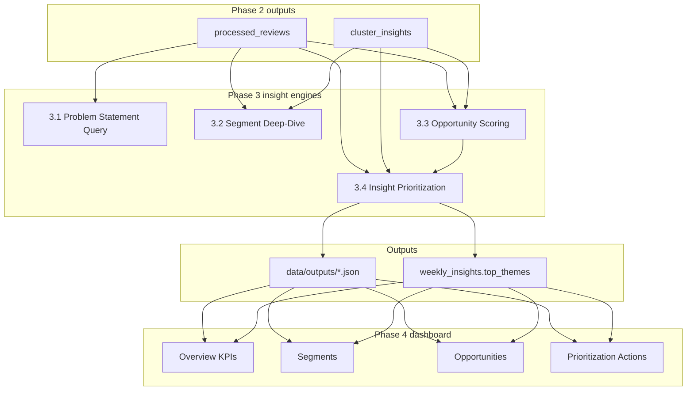

# Prioritization & Ranking Methodology

This document explains **how the Spotify Growth Intelligence analyzer ranks segments, opportunities, and actions**, and how the **Phase 3.4 Insight Prioritization Engine** is built.

It is intended for product reviewers, thesis evaluators, and engineers who need to understand what “#1” means on each dashboard screen.

---

## 1. Design principles

| Principle | What it means |
|-----------|----------------|
| **Evidence-backed only** | Rankings use review text, themes, sentiment, cluster insights, and behavioral segment labels from Phase 2. No inferred demographics (age, student/professional, etc.). |
| **Batch pipeline, live dashboard enrichment** | Scores are computed during the weekly Python pipeline and stored in JSON + `weekly_insights`. At request time, the Next.js dashboard may **recompute** counts and rankings from the 90-day review window when `getWindowCorpus()` succeeds (see §10). |
| **90-day analysis window** | Phase 3 engines filter reviews to a rolling **90-day window** (see ADR-004 in `decisions.md`). The dashboard corpus count is anchored to the **last weekly pipeline run date**. |
| **No per-review LLM in Phase 3** | Ranking uses aggregates and cluster-level LLM outputs from Phase 2.5 — not thousands of individual LLM calls. |
| **Multiple ranking lenses** | Different screens answer different product questions, so they use **different scoring formulas** (see §7). This is intentional, not a bug. |

---

## 2. Pipeline overview



**Key source files**

| Engine | Module | Output file |
|--------|--------|-------------|
| Segment deep-dive | `src/phase3_knowledge/segment_deep_dive.py` | `segment_deep_dives.json` |
| Opportunity scoring | `src/phase3_knowledge/opportunity_scoring.py` | `opportunity_scores.json` |
| Insight prioritization | `src/phase3_knowledge/insight_prioritization.py` | `insight_prioritization.json` |

---

## 3. Behavioral segments (what gets ranked)

Phase 3 ranks **six behavioral segments**, not raw Phase 2 labels:

- Discovery Seeker
- Habit Listener
- Heavy Listener
- Playlist Driven
- Niche Listener
- Casual Listener

Each review is mapped from Phase 2 `user_segment` plus text/theme overrides (playlist language → Playlist Driven; discovery language → Discovery Seeker). See `problem_statement_engine.py` → `normalize_behavioral_segment()`.

All segment rankings operate on these behavioral labels within the active 90-day review set.

---

## 4. Segment friction score (primary segment rank)

**Used by:** Segment cohort cards (Behavior lens), Overview “Highest-friction audience” (Behavior), Prioritization segment actions, Phase 3.4 segment friction list.

**Computed in:** `insight_prioritization.py` → `compute_segment_friction_scores()`

For each behavioral segment, over all reviews in the window:

| Metric | Weight | Definition |
|--------|--------|------------|
| **Negative sentiment %** | 35% | Share of reviews with `sentiment_label = negative` |
| **Pain-point density** | 30% | Share of reviews with a cluster pain point attached |
| **Discovery-theme prevalence** | 35% | Share of reviews tagged with discovery-related themes (discover, repetitive, recommendation, playlist fatigue, algorithm, search, niche, explore) |
| **Severity multiplier** | × (avg cluster severity ÷ 5) | Boosts friction when reviews sit in high-severity clusters (1–5 from Phase 2.5) |

**Formula**

```
friction = 0.35 × (negative_pct/100)
         + 0.30 × pain_point_density
         + 0.35 × (discovery_theme_pct/100)

if avg_cluster_severity exists:
    friction = min(1.0, friction × (avg_cluster_severity / 5))
```

Segments are sorted **descending by `friction_score`**. Higher = more discovery friction signal in that cohort.

**Interpretation:** A segment can rank #1 on friction even with fewer total reviews if its **negative rate and discovery pain density** are highest (e.g. Habit Listener at ~37% negative vs Playlist Driven at ~24% with much larger volume).

---

## 5. Segment comparison rankings (Phase 3.2)

**Used by:** Segments page header (“Highest friction”), segment matrix Discovery/Upsell rows, Insights “Who Is Struggling Most” narrative.

**Computed in:** `segment_deep_dive.py` → `build_segment_comparison()`

Three **separate** weighted-signal rankings. For each review in a segment, if theme or text patterns match:

| Signal type | Base | + if negative | + if sentiment ≤ 2 |
|-------------|------|---------------|---------------------|
| Per matching review | +1.0 | +1.5 | +0.5 |

### 5.1 Repetitive listening score

- **Themes:** Repetitive Recommendations, Playlist Fatigue
- **Text:** same song, same artist, repeat, over and over, playlist fatigue

### 5.2 Recommendation fatigue score

- **Themes:** Repetitive Recommendations, Playlist Fatigue, Recommendation Quality
- **Text:** recommend, suggest, algorithm, Discover Weekly, Daily Mix, repetitive, boring
- **Segments page header** uses the #1 segment on **this** ranking as `highest_friction_segment`.

### 5.3 Discovery failure score

- **Themes:** Search & Discovery UX, Discover Weekly Issues, Recommendation Quality, Niche Discovery Issues
- **Text:** can't find, hard to find, discover, explore, find new, no new music, stuck

Each list is sorted by **total weighted signal count** (volume-weighted, not percentage).

### 5.4 Insights “Who Is Struggling Most”

**Computed in:** `problem_statement_engine.py` (question `segment_discovery_challenges`)

Separate weighted sum per segment on discovery-filtered reviews:

- +1.0 base per relevant review
- +1.5 if negative
- +1.0 if themes include discover/repetitive

Top segment by total weight is named in the finding summary.

---

## 6. Pain-point ranking

**Used by:** Prioritization matrix (pain_point rows), Pain lens on Segments, Overview executive summary candidate.

**Computed in:** `compute_top_pain_points()`

```
impact_score = frequency × (avg_cluster_severity / 5)
```

- **Frequency** — review count attributed to each cluster pain point (from `cluster_insights`, plus review-level fallbacks)
- **Severity** — cluster severity 1–5 from Phase 2.5 LLM insights

Pain points are sorted by **`impact_score` descending**. Top 5 enter the prioritization matrix.

---

## 7. Opportunity ranking (Phase 3.3)

**Used by:** Opportunities → Ranking tab, Overview “Priority opportunity” KPI, Prioritization matrix (opportunity rows).

**Computed in:** `opportunity_scoring.py` → `build_opportunity_candidates()`

### 7.1 Candidates

One opportunity per **semantic cluster** from `cluster_insights`:
- `pain_point`, `product_opportunity`, `feature_request`, `severity`, themes, quotes

Opportunities mentioning unsupported demographics (age group, students, parents, etc.) are **excluded**.

### 7.2 Composite score

```
Score = Frequency × Severity × Segment Impact × Sentiment Intensity
```

| Factor | Range | How computed |
|--------|-------|--------------|
| **Frequency** | 0–1 | Cluster review count ÷ largest cluster count in window |
| **Severity** | 0–1 | Cluster severity (1–5) ÷ 5 |
| **Segment impact** | 0–1 | Share of cluster reviews in high-friction behavioral segments (Playlist Driven, Habit Listener, Discovery Seeker) |
| **Sentiment intensity** | 0–1 | Blend of negative % and low sentiment scores (1–2 = stronger intensity) |

```
composite = frequency × severity × segment_impact × sentiment_intensity
```

Candidates sorted by **composite descending** → assigned **rank 1, 2, 3…**

### 7.3 Opportunity tiers

| Tier | Rule |
|------|------|
| **Critical** | Rank ≤ 2 **or** composite ≥ 0.12 |
| **High** | Rank ≤ 5 **or** composite ≥ 0.06 |
| **Monitor** | Everything else |

---

## 8. Insight Prioritization Engine (Phase 3.4)

**Used by:** Opportunities → Actions tab, Overview executive summary (#1 item), PDF export prioritization section.

**Entry point:** `run_insight_prioritization()` in `insight_prioritization.py`

### 8.1 Inputs merged

| Stream | Source | Max items in matrix |
|--------|--------|---------------------|
| Pain points | §6 impact ranking | Top 5 |
| Opportunities | §7 composite ranking | Top 5 |
| Segment friction | §4 friction score | Top 3 segments |
| Emerging issues | Week-over-week theme spikes ≥ 25% | Top 3 |

### 8.2 Priority score per action type

| Type | `priority_score` |
|------|------------------|
| **pain_point** | Normalized impact score: `impact_score / max(impact_scores)`, then tier uses `norm × 0.15` |
| **opportunity** | Opportunity `composite` score (unchanged) |
| **segment_friction** | Segment `friction_score` (unchanged) |
| **emerging_issue** | `min(1.0, change_pct / 100)` from week-over-week spike |

### 8.3 Unified ranking

All actions are merged into one list, sorted by **`priority_score` descending**, then assigned **`rank` 1…N**.

`top_priority` = matrix item at rank #1 (drives Overview “Key finding this period”).

### 8.4 Action tiers (matrix)

| Tier | Rule |
|------|------|
| **Critical** | `priority_score ≥ 0.12` |
| **High** | `priority_score ≥ 0.05` |
| **Monitor** | Below 0.05 |

Pain-point rows use a scaled threshold (`norm × 0.15`) before tier assignment. Opportunity rows reuse opportunity tiers from §7.3.

### 8.5 Emerging issue detection

1. Prefer `historical_trends` table (theme mention count week-over-week)
2. Fallback: compare last 7 days vs prior 7 days of review themes
3. Flag themes with **≥ 25% growth** (`SPIKE_THRESHOLD_PCT`)
4. Sort by `change_pct` descending

---

## 9. Where rankings appear in the dashboard

| Screen | What is ranked | Sort / #1 rule |
|--------|----------------|----------------|
| **Overview → Reviews analyzed** | Corpus size | Date-filtered count in 90-day window (not a rank) |
| **Overview → Highest-friction audience** | Behavioral segment | Highest **friction score** (§4) for selected lens |
| **Overview → Priority opportunity** | Product opportunity | Opportunity **rank #1** by composite (§7) |
| **Overview → Key finding** | Unified action | Prioritization matrix **rank #1** (§8) |
| **Segments → header** | Behavioral segment | Highest **recommendation fatigue** signal (§5.2) |
| **Segments → cohort cards** | Profiles in active lens | **Friction score** descending (§4) |
| **Segments → sub-cluster table** | Behavioral segments | **Review volume** descending (not friction) |
| **Segments → matrix** | Cross-segment metrics | Normalized repetitive / fatigue / discovery scores (§5) |
| **Opportunities → Ranking** | Cluster opportunities | **Composite score** → rank 1–5 |
| **Opportunities → Actions** | Pain + segment + opportunity + emerging | **Priority score** → rank 1–N |
| **Insights → Who Is Struggling Most** | Behavioral segments | Weighted discovery-challenge signals (§5.4) |

---

## 10. Important distinctions

### Why “#1 segment” differs across screens

This is **by design**:

- **Friction score (#4)** — “Which cohort has the worst negative + pain + discovery mix **relative to its size**?”
- **Recommendation fatigue (#5.2)** — “Which cohort generates the **most total** recommendation/playlist complaint signals?”
- **Volume table** — “Which cohort has the **most reviews**?”

Example from a typical run:

| Lens | #1 segment | Why |
|------|------------|-----|
| Friction score | Habit Listener | Highest negative % + pain density |
| Recommendation fatigue / header | Playlist Driven | Largest absolute complaint volume |
| Review volume | Playlist Driven | Most reviews in corpus |

### Snapshot vs live 90-day window

Phase 3 JSON stores `total_reviews_analyzed` from the pipeline run. The live dashboard uses a two-layer model:

1. **Pipeline snapshot (base)** — Phase 3 JSON in `weekly_insights.top_themes` provides structure: pain points, cluster IDs, quotes, tier labels, and segment profile metadata.
2. **Window corpus (live overlay)** — `getWindowCorpus()` in `window-corpus.ts` loads `processed_reviews` joined with `raw_reviews` where `review_date ∈ [anchor − 90 days, anchor]`. `apply-window-corpus.ts` then overrides:
   - Corpus count and segment card review counts
   - Friction scores and recommendation-fatigue ranking
   - Opportunity composite scores and ranks
   - Prioritization matrix order and evidence counts
   - Overview sentiment, dominant themes, analytics heatmap

**Anchor date:** `resolveAnalysisAnchorDate()` uses the latest weekly pipeline `generated_at` / `weekly_insights.created_at`, not the browser clock.

**Fallback:** If the corpus fetch times out (~18s) or Supabase is unavailable, loaders keep snapshot metrics and set `totalReviews` via `fetchCanonicalCorpusReviewCount()` (date-filtered `raw_reviews` count).

**Note:** `fetchProcessedReviewCount()` counts **`raw_reviews`** by `review_date`, not `processed_reviews` rows.

---

## 11. Outputs & storage

After each weekly run, Phase 3.4 writes:

```json
{
  "segment_friction_scores": [...],
  "top_pain_points": [...],
  "opportunity_rankings": [...],
  "emerging_issues": [...],
  "prioritization_matrix": [...],
  "tier_summary": { "Critical": N, "High": M, ... },
  "top_priority": { "rank": 1, "tier": "Critical", ... }
}
```

Stored locally at `data/outputs/insight_prioritization.json` and merged into Supabase `weekly_insights.top_themes.insight_prioritization`.

The Next.js dashboard reads these via `fetchMergedTopThemes()` (`frontend/src/lib/data/weekly-insights-merge.ts`) and may overlay live 90-day metrics via `window-corpus.ts` + `apply-window-corpus.ts`.

---

## 12. Running the engines manually

```bash
# Opportunity ranking only (Phase 3.3)
python -m src.phase3_knowledge.opportunity_scoring

# Full prioritization bundle (Phase 3.4 — includes 3.3 opportunities)
python -m src.phase3_knowledge.insight_prioritization

# Optional date filter (must match dashboard window)
python -m src.phase3_knowledge.insight_prioritization --date-start 2026-03-30
```

Default filters use `default_analysis_filters()` → rolling 90 days from run time (`ANALYSIS_WINDOW_DAYS = 90` in `src/phase2_analysis/prompts.py`).

---

## 13. Related documents

- `architecture.md` — Phase 3 layer overview
- `decisions.md` — ADR-006 (behavioral segments), ADR-007 (insight engines)
- `implementationPlan.md` — Phase 3.3 / 3.4 specifications
- `pdf-report.md` — How ranked outputs appear in exported PDF

---

## 14. Summary

| Question | Answer |
|----------|--------|
| How are **opportunities** ranked? | `Frequency × Severity × Segment Impact × Sentiment Intensity` per cluster |
| How are **segments** ranked (primary)? | Weighted friction: negative % + pain density + discovery themes, severity-adjusted |
| How is the **action list** built? | Merge top pain points, opportunities, friction segments, and emerging spikes; sort by `priority_score` |
| What does **Critical / High / Monitor** mean? | Threshold bands on composite or priority scores — not manual labels |
| Are rankings demographic? | **No** — behavioral only, from review language and Phase 2 classifications |

The prioritization engine turns raw review intelligence into a **single ordered action list** product teams can execute against, while keeping each scoring method auditable and tied to stored evidence (quotes, cluster IDs, segment breakdowns).
